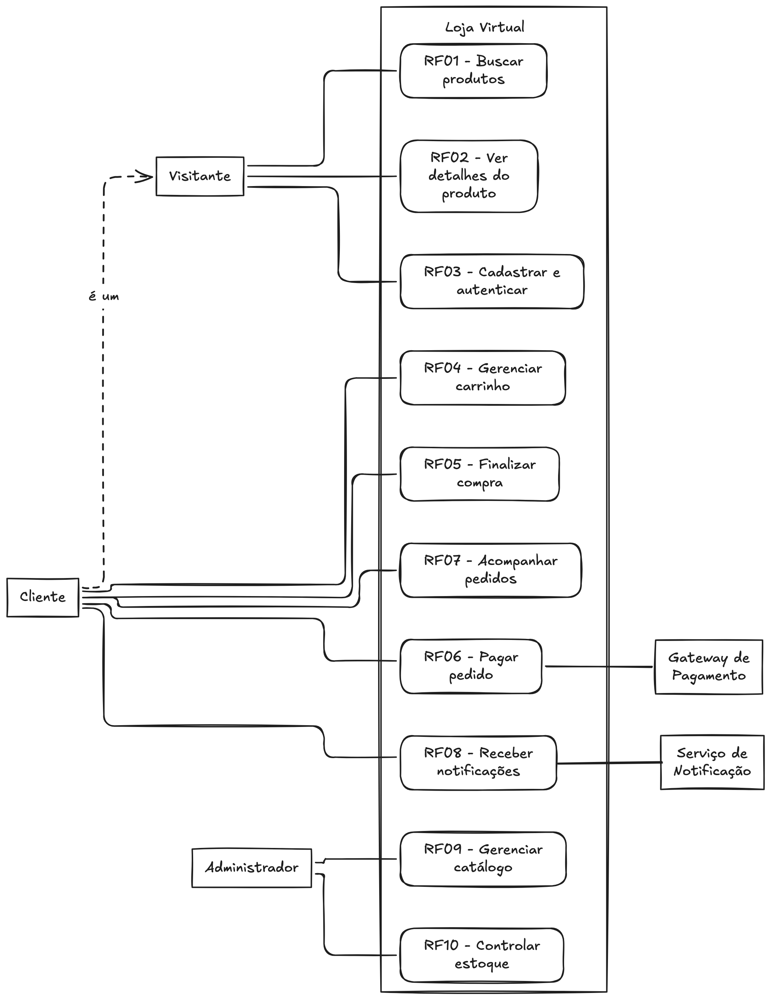

# Loja Virtual

Trabalho final de Arquitetura de Software. Sistema de e-commerce documentado com o modelo C4 (Structurizr) e implementado parcialmente.

> Status: em definição. Itens marcados com **[A DEFINIR]** dependem de decisão do grupo.

## Sumário

- [Escopo](#escopo)
- [Atores](#atores)
- [Requisitos funcionais](#requisitos-funcionais)
- [Requisitos não funcionais](#requisitos-não-funcionais)
- [Fluxo principal da demonstração](#fluxo-principal-da-demonstração)
- [Decisões arquiteturais pendentes](#decisões-arquiteturais-pendentes)
- [Estrutura do repositório](#estrutura-do-repositório)
- [Como executar](#como-executar)
- [Equipe e divisão de atividades](#equipe-e-divisão-de-atividades)
- [Calendário](#calendário)

## Escopo

Loja virtual com catálogo, carrinho, pedidos e controle de estoque, com integração de pagamento e notificações. A inspiração em Amazon e Mercado Livre vem da busca, da página de produto, do checkout e do acompanhamento de pedido, mantendo interface minimalista e foco em objetividade.

**Premissa (a validar):** uma única loja, administrada por um perfil interno. Não é um marketplace com vários vendedores.

**Fora de escopo:** avaliações, recomendações, cupons, cálculo de frete real, devoluções e chat.

**Estilo arquitetural:** SOA, com cada serviço desenhado em Arquitetura Hexagonal ([ADR-0001](docs/adr/0001-estilo-arquitetural.md)).

## Atores

| Ator | Tipo | Descrição |
|---|---|---|
| Visitante | Primário | Navega e busca produtos sem login |
| Cliente | Primário | Visitante autenticado, que compra e acompanha pedidos |
| Administrador | Primário | Gerencia catálogo e estoque |
| Gateway de Pagamento | Externo (simulado) | Autoriza ou recusa pagamentos |
| Serviço de Notificação | Externo (simulado) | Envia e-mail ou push ao cliente |

### Diagrama de casos de uso



O Cliente herda de Visitante, então também busca produtos e vê detalhes (RF01, RF02). Fonte em Mermaid: [casos-de-uso.md](docs/use-cases/casos-de-uso.md).

## Requisitos funcionais

Escritos no padrão **3C** (Card, Conversa, Confirmação).

### RF01: Buscar produtos (Visitante)
- **Card:** Como visitante, quero buscar e filtrar produtos por nome, categoria e faixa de preço, para encontrar o que preciso rapidamente.
- **Conversa:** Busca textual simples ou com índice? Critérios de ordenação?
- **Confirmação:** Dado o termo "caneta", quando busco, então vejo só produtos cujo nome ou descrição o contêm. Dado um filtro de preço, então nenhum item fora da faixa aparece.

### RF02: Ver detalhes do produto (Visitante)
- **Card:** Como visitante, quero ver foto, descrição, preço e disponibilidade, para decidir a compra.
- **Conversa:** Quantas imagens por produto? Exibir a quantidade exata em estoque ou só "disponível/indisponível"?
- **Confirmação:** Dado um produto sem estoque, então a página mostra "indisponível" e desabilita "adicionar ao carrinho".

### RF03: Cadastro e login (Cliente)
- **Card:** Como cliente, quero criar conta e autenticar, para comprar e consultar meus pedidos.
- **Conversa:** Autenticação própria ou delegada (OAuth)? Endereço de entrega fica no cadastro ou no checkout?
- **Confirmação:** Dado um e-mail já cadastrado, então o cadastro é rejeitado. Dadas credenciais inválidas, então o acesso é negado.

### RF04: Gerenciar carrinho (Cliente)
- **Card:** Como cliente, quero adicionar, remover e alterar a quantidade de itens no carrinho, para montar minha compra.
- **Conversa:** O carrinho persiste entre sessões? Adicionar ao carrinho reserva estoque? (sugestão: não)
- **Confirmação:** Dado um item no carrinho, quando altero a quantidade, então o subtotal é recalculado. Dada uma quantidade acima do estoque, então a alteração é rejeitada.

### RF05: Finalizar compra (Cliente) — fluxo principal
- **Card:** Como cliente, quero transformar meu carrinho em um pedido, para efetivar a compra.
- **Conversa:** O estoque é reservado na criação do pedido ou só após o pagamento? Qual o prazo de expiração de pedidos não pagos?
- **Confirmação:** Dado um carrinho válido, quando finalizo, então um pedido com status "Aguardando pagamento" é criado e o estoque é reservado. Dado que um item esgotou nesse intervalo, então o pedido não é criado e o cliente é informado.

### RF06: Pagar pedido (Cliente, Gateway) — fluxo principal
- **Card:** Como cliente, quero pagar meu pedido por um meio de pagamento, para concluir a compra.
- **Conversa:** Quais meios simular (cartão, PIX, boleto)? O retorno do gateway é síncrono ou por evento?
- **Confirmação:** Dado pagamento aprovado, então o pedido passa a "Pago" e o estoque é baixado definitivamente. Dado pagamento recusado, então o pedido permanece pendente e a reserva é mantida até o prazo de expiração, quando é liberada.

### RF07: Acompanhar pedidos (Cliente)
- **Card:** Como cliente, quero ver a lista e o status dos meus pedidos, para saber em que etapa estão.
- **Conversa:** Quais status? (sugestão: Aguardando pagamento, Pago, Enviado, Entregue, Cancelado)
- **Confirmação:** Dado um cliente com pedidos, então ele vê apenas os seus, com o status atual.

### RF08: Receber notificações (Cliente, Serviço de Notificação) — fluxo principal
- **Card:** Como cliente, quero ser avisado quando o status do pedido mudar, para não precisar consultar o sistema.
- **Conversa:** Quais canais? A falha no envio deve bloquear o pedido? (sugestão: não)
- **Confirmação:** Dada uma mudança de status, então uma notificação é enviada. Dada falha no envio, então o pedido não é afetado e há nova tentativa ou registro do erro.

### RF09: Gerenciar catálogo (Administrador)
- **Card:** Como administrador, quero cadastrar, editar e desativar produtos, para manter o catálogo atualizado.
- **Conversa:** Exclusão física ou lógica? (sugestão: lógica, para preservar o histórico de pedidos)
- **Confirmação:** Dado um produto desativado, então ele some da busca, mas continua visível nos pedidos antigos.

### RF10: Controlar estoque (Administrador)
- **Card:** Como administrador, quero ajustar e consultar o estoque, para evitar venda de itens indisponíveis.
- **Conversa:** Como tratar concorrência (dois clientes comprando a última unidade)?
- **Confirmação:** Dado 1 unidade em estoque e dois pedidos simultâneos, então apenas um é aceito.

## Requisitos não funcionais

| ID | Requisito | Verificação |
|---|---|---|
| RNF01 | O domínio não pode depender de framework, banco ou serviços externos (gateway e notificação acessados por interfaces) | Revisão de dependências e testes de domínio sem infraestrutura |
| RNF02 | Pagamento e notificação devem ser substituíveis por simulações | Troca de adaptador sem alterar o domínio |
| RNF03 | Nenhuma venda além do estoque disponível | Teste de concorrência (RF10) |
| RNF04 | Senhas armazenadas com hash | Inspeção do banco |
| RNF05 | Código e diagramas C4 (Structurizr) consistentes | Revisão na entrega de 01/12 |

## Fluxo principal da demonstração

RF01 a RF10 formam o mínimo viável. Para a apresentação, será implementado o fluxo **RF04 → RF05 → RF06 → RF08**, com **RF10** como suporte. Ele exercita portas e adaptadores (pagamento, notificação, persistência) e a comunicação entre componentes.

## Decisões arquiteturais pendentes

Cada decisão deve virar um ADR em `docs/adr/`.

1. **Estilo arquitetural: DECIDIDO** — SOA, com Hexagonal em cada serviço ([ADR-0001](docs/adr/0001-estilo-arquitetural.md)).
2. **Fronteiras dos serviços: DECIDIDO** — Catálogo, Estoque, Pedidos (inclui carrinho), Pagamento, Notificação e Identidade no C4; a demonstração implementa Pedidos, Estoque, Pagamento e Notificação ([ADR-0002](docs/adr/0002-fronteiras-dos-servicos.md)).
3. **Comunicação entre serviços: DECIDIDO** — REST síncrono para comandos com resposta imediata e eventos para resultado de pagamento e notificações; API Gateway único como ponto de entrada ([ADR-0003](docs/adr/0003-comunicacao-entre-servicos.md)).
4. **Reserva de estoque: DECIDIDO** — na criação do pedido; baixa no pagamento aprovado e liberação no recusado ([ADR-0004](docs/adr/0004-reserva-de-estoque.md)).
5. **Retorno do gateway: DECIDIDO** — resposta síncrona da cobrança + evento publicado sempre; o estado final muda só pelo evento ([ADR-0005](docs/adr/0005-retorno-do-gateway.md)).
6. **Autenticação [A DEFINIR]:** própria ou delegada. Fora da demonstração (cliente fixo).

## Estrutura do repositório

```
.
├── README.md
├── docker-compose.yml      # sobe MySQL, RabbitMQ e as 5 APIs
├── docs/
│   ├── adr/                # registros de decisões arquiteturais
│   ├── c4/                 # diagramas C4 (Structurizr/Mermaid)
│   └── use-cases/          # diagrama de casos de uso
└── src/                    # backend (cada serviço em Node.js + Express)
    ├── mysql/init/         # schema e seed do banco (executados na 1ª subida)
    ├── gateway/            # API Gateway - POST /checkout
    ├── pedidos/            # API de Pedido - POST /pedidos
    ├── estoque/            # API de Estoque - POST /reservas
    ├── pagamento/          # API de Pagamento - POST /cobrancas
    └── notificacao/        # API de Notificação - GET /notificacoes
```

Cada serviço segue o padrão hexagonal (ADR-0001): `domain/` (entidade), `application/` (caso de uso + portas), `adapters/in` e `adapters/out` (adaptadores de banco, RabbitMQ e demais APIs) e `infrastructure/` (configuração e composição).

## Como executar

Requisitos: Docker com Docker Compose.

```bash
docker compose up -d        # sobe MySQL, RabbitMQ e as 5 APIs
docker compose down -v      # para e apaga o volume (reexecuta o init do MySQL)
```

Portas:

| Serviço | Porta | Endpoint |
|---|---|---|
| API Gateway | 3000 | `POST /checkout` |
| Pedidos | 3001 | `POST /pedidos` |
| Estoque | 3002 | `POST /reservas` |
| Pagamento | 3003 | `POST /cobrancas` |
| Notificação | 3004 | `GET /notificacoes` |
| MySQL | 3307 | banco `loja_virtual` |
| RabbitMQ (painel) | 15672 | login `loja` / `loja` |

Exemplo de fluxo principal (dados mockados):

```bash
curl -X POST http://localhost:3000/checkout \
  -H 'content-type: application/json' \
  -d '{"clienteId":"cliente-1","itens":[{"produtoId":1,"quantidade":2}]}'
# -> pedido criado e, em seguida, evento de pagamento o leva a "Pago"
```

## Equipe e divisão de atividades

| Integrante | Responsabilidades |
|---|---|
| Josias | Docker Compose e Dockerfiles, schema/seed do MySQL, gateway, serviço de Pedidos, integração e documentação |
| Rafael | Serviços de Estoque, Pagamento e Notificação, dados mockados e roteiro da demonstração |

## Calendário

| Data | Entrega |
|---|---|
| 16/11 e 17/11 | Equipe alinhada, aplicação e funcionalidades documentadas, estilo arquitetural selecionado, repositório criado, diagramas de Contexto e Container |
| 22/11 | Revisão das entregas: backend rodando no Docker com dados mockados e apresentação |
| 23/11 e 24/11 | Diagramas de Componentes e Código |
| 01/12, 07/12 e 08/12 | Código rodando, conformidade com os diagramas e apresentação para a turma |