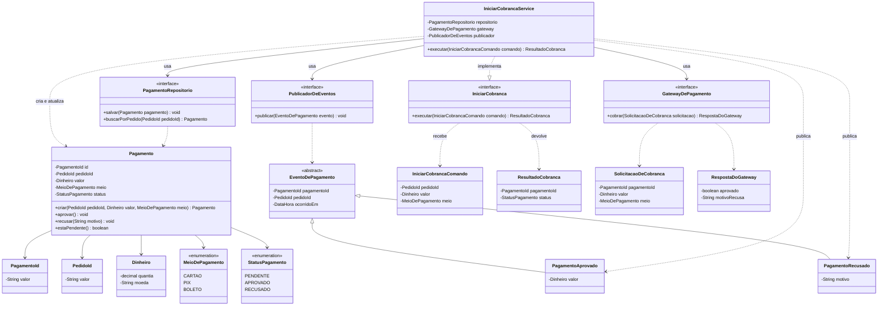
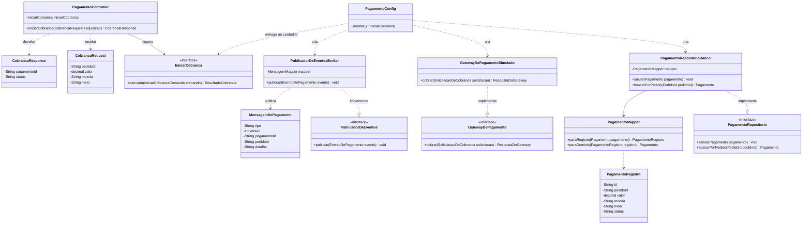

# C4 — Diagrama de Código: serviço de Pagamento (nível 4)

Detalha em UML (diagrama de classes) os componentes do [diagrama de Componentes do Pagamento](componentes-pagamento.md). O serviço segue Clean Architecture + Hexagonal ([ADR-0001](../adr/0001-estilo-arquitetural.md)): o núcleo (domínio e aplicação) não depende de REST, banco, broker nem do gateway; os adaptadores dependem do núcleo, nunca o contrário.

O diagrama está dividido em duas visões, que se ligam pelas interfaces das portas:

1. **Núcleo:** domínio, caso de uso e portas.
2. **Adaptadores e composição:** o que implementa as portas e como tudo é montado.

Os nomes são neutros quanto à linguagem e ao framework, que ainda não foram escolhidos. Adapte a nomenclatura (português ou inglês, convenções da linguagem) quando a stack for definida.

## Visão 1 — Núcleo (domínio e aplicação)

## Visão 2 — Adaptadores e composição

As interfaces `IniciarCobranca`, `PagamentoRepositorio`, `GatewayDePagamento` e `PublicadorDeEventos` são as mesmas da visão 1, repetidas aqui só como ponto de ligação.

## Camada e pasta de cada classe

Pastas conforme a estrutura-base do ADR-0001.

| Classe | Camada | Pasta |
|---|---|---|
| `Pagamento`, `StatusPagamento`, `MeioDePagamento`, `Dinheiro`, `PagamentoId`, `PedidoId` | Domínio | `domain/` |
| `EventoDePagamento`, `PagamentoAprovado`, `PagamentoRecusado` | Domínio (eventos) | `domain/` |
| `IniciarCobranca`, `IniciarCobrancaService`, `IniciarCobrancaComando`, `ResultadoCobranca` | Aplicação (caso de uso) | `application/` |
| `PagamentoRepositorio`, `GatewayDePagamento`, `PublicadorDeEventos`, `SolicitacaoDeCobranca`, `RespostaDoGateway` | Aplicação (portas de saída) | `application/` |
| `PagamentoController`, `CobrancaRequest`, `CobrancaResponse` | Adaptador de entrada | `adapters/in/` |
| `PagamentoRepositorioBanco`, `PagamentoRegistro`, `PagamentoMapper` | Adaptador de saída (persistência) | `adapters/out/` |
| `GatewayDePagamentoSimulado` | Adaptador de saída (gateway) | `adapters/out/` |
| `PublicadorDeEventosBroker`, `MensagemDePagamento` | Adaptador de saída (mensageria) | `adapters/out/` |
| `PagamentoConfig` | Composição | `infrastructure/` |

## Fluxo do caso de uso `IniciarCobrancaService.executar`

1. Busca um pagamento existente do pedido (`buscarPorPedido`); se existir, devolve o resultado dele sem cobrar de novo (idempotência).
2. Cria o `Pagamento` com status `PENDENTE` (`criar`) e o salva.
3. Chama `GatewayDePagamento.cobrar` com a `SolicitacaoDeCobranca`.
4. Se aprovado, chama `aprovar()`; senão, `recusar(motivo)`. A transição só vale a partir de `PENDENTE`.
5. Salva o pagamento atualizado.
6. Publica `PagamentoAprovado` ou `PagamentoRecusado` pelo `PublicadorDeEventos`.
7. Devolve `ResultadoCobranca`.

## Observações

- **Regras do domínio:** o valor deve ser maior que zero e `Pagamento` só muda de status a partir de `PENDENTE`. Essas regras ficam em `Pagamento`, não no caso de uso, e podem ser testadas sem infraestrutura (RNF01).
- **Substituição do gateway (RNF02):** trocar o simulado por outro é criar uma nova implementação de `GatewayDePagamento` e mudar só `PagamentoConfig`.
- **Contrato do evento:** `MensagemDePagamento` é o contrato versionado publicado no broker (ADR-0003); o domínio não conhece esse formato, só o `PublicadorDeEventosBroker`.
- **Retorno do gateway por callback (decisão aberta):** se for assim, entram um adaptador de entrada (webhook) e um segundo caso de uso, por exemplo `ConfirmarPagamento`, que faria os passos 4 a 6; `IniciarCobrancaService` pararia no passo 3.
- **Salvar e publicar:** se o passo 5 funcionar e o 6 falhar, o pagamento fica registrado sem o evento. Garantir isso (por exemplo com o padrão outbox) não está decidido e pode ser tratado em um ADR próprio.
- **Meios de pagamento:** `CARTAO`, `PIX` e `BOLETO` são candidatos, ainda não decididos (RF06).
- **Resposta REST:** o fluxo acima assume que o gateway simulado responde na hora, então `CobrancaResponse` já pode trazer o status final (`APROVADO` ou `RECUSADO`), e o evento continua sendo publicado para Pedidos e Estoque. O [diagrama de Componentes](componentes-pagamento.md) sugere devolver só a confirmação do registro; é preciso escolher um dos dois junto com a decisão sobre o retorno do gateway.
