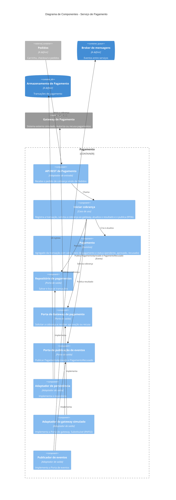
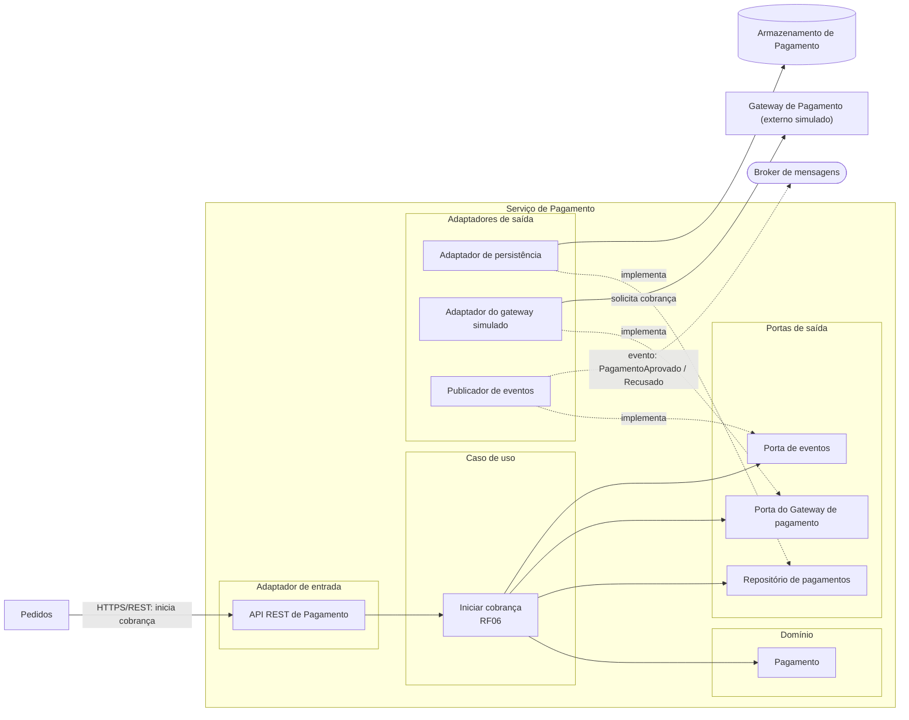

# C4 — Diagrama de Componentes: serviço de Pagamento (nível 3)

Abre o container **Pagamento** do [diagrama de Container](containers.md). O serviço segue Clean Architecture + Hexagonal ([ADR-0001](../adr/0001-estilo-arquitetural.md)): o caso de uso e o domínio não conhecem REST, banco, broker nem o gateway de pagamento; tudo isso entra e sai por **portas**, implementadas por **adaptadores**. Isso atende RNF01 e RNF02: o gateway é substituível por uma simulação sem mexer no domínio.

O serviço cobre o RF06 (pagar pedido). É iniciado por Pedidos via REST e informa o resultado por evento ([ADR-0003](../adr/0003-comunicacao-entre-servicos.md)).

Correspondência com a estrutura de pastas do ADR-0001:

| Camada | Componentes | Pasta |
|---|---|---|
| Adaptador de entrada | API REST de Pagamento | `adapters/in/` |
| Caso de uso | Iniciar cobrança | `application/` |
| Domínio | Pagamento | `domain/` |
| Portas de saída | Repositório de pagamentos, Gateway de pagamento, Eventos | `application/` |
| Adaptadores de saída | Persistência, Adaptador do gateway simulado, Publicador de eventos | `adapters/out/` |

## Versão C4 nativa do Mermaid

Usa `C4Component`, que o GitHub renderiza. O Mermaid to Excalidraw **não** converte esse tipo; para o Excalidraw use a versão em `flowchart` abaixo. A camada de cada componente está no campo de tecnologia.

## Versão em flowchart (para o Excalidraw)

Mesmo conteúdo, organizado em camadas. Linha sólida é uso ou chamada; linha tracejada é "implementa" (adaptador → porta) ou evento via broker, e o rótulo diz qual.

## Observações

- **Retorno do gateway:** se o gateway responde na hora ou por callback ainda está em aberto. Se for síncrono, só o Adaptador do gateway simulado muda. Se for por callback, entra um **adaptador de entrada** novo (webhook) chamando um caso de uso de confirmar pagamento, e Iniciar cobrança passa a só registrar a transação como pendente e disparar a solicitação.
- **O que Pedidos recebe na resposta REST:** o resultado chega por evento (ADR-0003), então a resposta ao iniciar a cobrança deve ser apenas a confirmação de que a transação foi registrada. Se a resposta passar a carregar o resultado, o contrato REST muda.
- **Meios de pagamento:** cartão, PIX ou boleto ainda não foram escolhidos (RF06). Isso afeta o domínio (Pagamento) e a Porta do gateway, não a estrutura do diagrama.
- **Reservas:** a baixa ou liberação do estoque após o resultado é feita por Estoque ao consumir o evento, não por este serviço (veja o diagrama de Container); depende da decisão de reserva de estoque.
- **Idempotência:** um pedido de cobrança repetido para o mesmo pedido não deve gerar duas cobranças; a transação deve ser identificada pelo pedido.
- **Armazenamento:** banco por serviço ou compartilhado ainda está em aberto e a tecnologia é "A definir".
