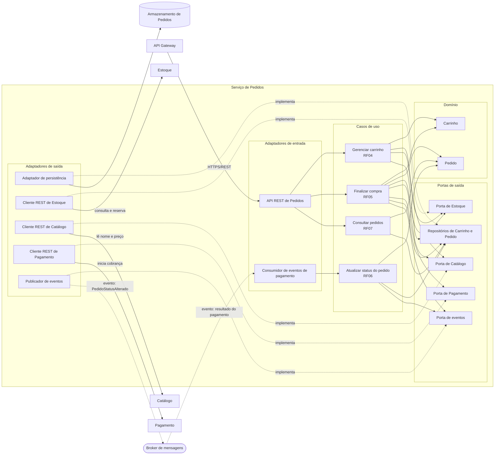

# C4 — Diagrama de Componentes: serviço de Pedidos (nível 3)

Abre o container **Pedidos** do [diagrama de Container](containers.md). O serviço segue Clean Architecture + Hexagonal ([ADR-0001](../adr/0001-estilo-arquitetural.md)): os casos de uso e o domínio não conhecem REST, banco nem broker; tudo que entra ou sai passa por **portas**, implementadas por **adaptadores**.

O serviço cobre carrinho, checkout e consulta de pedidos (RF04, RF05, RF07) e aplica o resultado do pagamento (RF06). Comunicação conforme o [ADR-0003](../adr/0003-comunicacao-entre-servicos.md).

Correspondência com a estrutura de pastas do ADR-0001:

| Camada | Componentes | Pasta |
|---|---|---|
| Adaptadores de entrada | API REST de Pedidos, Consumidor de eventos de pagamento | `adapters/in/` |
| Casos de uso | Gerenciar carrinho, Finalizar compra, Consultar pedidos, Atualizar status do pedido | `application/` |
| Domínio | Carrinho, Pedido | `domain/` |
| Portas de saída | Repositórios, Estoque, Catálogo, Pagamento, Eventos | `application/` |
| Adaptadores de saída | Persistência, clientes REST, publicador de eventos | `adapters/out/` |

## Versão C4 nativa do Mermaid

Usa `C4Component`, que o GitHub renderiza. O Mermaid to Excalidraw **não** converte esse tipo; para o Excalidraw use a versão em `flowchart` abaixo. A camada de cada componente está no campo de tecnologia.

```mermaid
C4Component
    title Diagrama de Componentes - Serviço de Pedidos

    Container_Ext(gateway, "API Gateway", "A definir", "Ponto único de entrada")
    Container_Ext(estoque, "Estoque", "A definir", "Saldo, reserva e baixa")
    Container_Ext(catalogo, "Catálogo", "A definir", "Produtos e preços")
    Container_Ext(pagamento, "Pagamento", "A definir", "Cobrança do pedido")
    ContainerQueue(broker, "Broker de mensagens", "A definir", "Eventos entre serviços")
    ContainerDb(db, "Armazenamento de Pedidos", "A definir", "Carrinhos e pedidos")

    Container_Boundary(pedidos, "Pedidos") {
        Component(rest, "API REST de Pedidos", "Adaptador de entrada", "Expõe carrinho, checkout e consulta de pedidos")
        Component(consumidor, "Consumidor de eventos de pagamento", "Adaptador de entrada", "Recebe PagamentoAprovado e PagamentoRecusado. Idempotente")

        Component(ucCarrinho, "Gerenciar carrinho", "Caso de uso", "Adiciona, remove e altera itens. Valida a quantidade e obtém o preço (RF04)")
        Component(ucFinalizar, "Finalizar compra", "Caso de uso", "Valida o carrinho, reserva estoque, cria o pedido e inicia a cobrança (RF05)")
        Component(ucConsultar, "Consultar pedidos", "Caso de uso", "Lista os pedidos do cliente com o status atual (RF07)")
        Component(ucStatus, "Atualizar status do pedido", "Caso de uso", "Aplica o resultado do pagamento ao pedido (RF06)")

        Component(carrinho, "Carrinho", "Domínio", "Agregado com itens, quantidades e subtotal")
        Component(pedido, "Pedido", "Domínio", "Agregado com itens (nome e preço copiados), status e regras de transição")

        Component(portaRepo, "Repositórios de Carrinho e Pedido", "Porta de saída", "Salvar e buscar carrinhos e pedidos")
        Component(portaEstoque, "Porta de Estoque", "Porta de saída", "Consultar disponibilidade e reservar")
        Component(portaCatalogo, "Porta de Catálogo", "Porta de saída", "Obter nome e preço do produto")
        Component(portaPagamento, "Porta de Pagamento", "Porta de saída", "Iniciar a cobrança")
        Component(portaEventos, "Porta de publicação de eventos", "Porta de saída", "Publicar PedidoStatusAlterado")

        Component(adRepo, "Adaptador de persistência", "Adaptador de saída", "Implementa os repositórios")
        Component(adEstoque, "Cliente REST de Estoque", "Adaptador de saída", "Implementa a Porta de Estoque")
        Component(adCatalogo, "Cliente REST de Catálogo", "Adaptador de saída", "Implementa a Porta de Catálogo")
        Component(adPagamento, "Cliente REST de Pagamento", "Adaptador de saída", "Implementa a Porta de Pagamento")
        Component(adEventos, "Publicador de eventos", "Adaptador de saída", "Implementa a Porta de eventos")
    }

    Rel(gateway, rest, "Carrinho, checkout e consulta", "HTTPS/REST")
    Rel(broker, consumidor, "Resultado do pagamento", "Evento")

    Rel(rest, ucCarrinho, "Chama")
    Rel(rest, ucFinalizar, "Chama")
    Rel(rest, ucConsultar, "Chama")
    Rel(consumidor, ucStatus, "Chama")

    Rel(ucCarrinho, carrinho, "Usa")
    Rel(ucFinalizar, carrinho, "Usa")
    Rel(ucFinalizar, pedido, "Cria")
    Rel(ucStatus, pedido, "Atualiza")
    Rel(ucConsultar, pedido, "Lê")

    Rel(ucCarrinho, portaCatalogo, "Obtém preço")
    Rel(ucCarrinho, portaEstoque, "Consulta disponibilidade")
    Rel(ucCarrinho, portaRepo, "Persiste")
    Rel(ucFinalizar, portaEstoque, "Reserva estoque")
    Rel(ucFinalizar, portaCatalogo, "Confirma nome e preço")
    Rel(ucFinalizar, portaPagamento, "Inicia cobrança")
    Rel(ucFinalizar, portaRepo, "Persiste")
    Rel(ucFinalizar, portaEventos, "Publica status")
    Rel(ucConsultar, portaRepo, "Busca")
    Rel(ucStatus, portaRepo, "Persiste")
    Rel(ucStatus, portaEventos, "Publica status")

    Rel(adRepo, portaRepo, "Implementa")
    Rel(adEstoque, portaEstoque, "Implementa")
    Rel(adCatalogo, portaCatalogo, "Implementa")
    Rel(adPagamento, portaPagamento, "Implementa")
    Rel(adEventos, portaEventos, "Implementa")

    Rel(adRepo, db, "Lê e grava")
    Rel(adEstoque, estoque, "Consulta e reserva", "HTTPS/REST")
    Rel(adCatalogo, catalogo, "Lê nome e preço", "HTTPS/REST")
    Rel(adPagamento, pagamento, "Inicia a cobrança", "HTTPS/REST")
    Rel(adEventos, broker, "Publica PedidoStatusAlterado", "Evento")

    UpdateLayoutConfig($c4ShapeInRow="4", $c4BoundaryInRow="1")
```

## Versão em flowchart (para o Excalidraw)

Mesmo conteúdo, organizado em camadas. Linha sólida é uso ou chamada síncrona; linha tracejada é "implementa" (adaptador → porta) ou evento via broker, e o rótulo diz qual.

## Observações

- **Lacuna no ADR-0003:** o RF04 exige rejeitar quantidade acima do estoque, então Gerenciar carrinho consulta a disponibilidade no Estoque. O ADR-0003 só lista a chamada de **reservar**. O diagrama usa a mesma Porta de Estoque para as duas operações (consultar e reservar); vale acrescentar a consulta na tabela de interações do ADR.
- **Eventos de status:** o diagrama assume que `PedidoStatusAlterado` é publicado em toda transição, inclusive na criação do pedido ("Aguardando pagamento"). Confirmar com o RF08.
- **Idempotência:** o consumidor de eventos precisa tolerar mensagens repetidas (ADR-0003); por isso Atualizar status do pedido deve ignorar uma transição que já foi aplicada.
- **Expiração de pedidos não pagos:** ainda não decidida (RF05/RF06). Se entrar, aparece como outro adaptador de entrada (um agendador) chamando um caso de uso novo.
- **Armazenamento:** se haverá um banco por serviço ou um compartilhado ainda está em aberto, e a tecnologia é "A definir". O diagrama mostra um armazenamento só para o adaptador de persistência ter um destino.
- **Composição:** a injeção de dependência que liga adaptadores às portas fica em `infrastructure/` (ADR-0001) e não aparece como componente.
