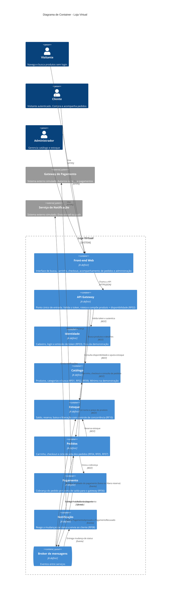
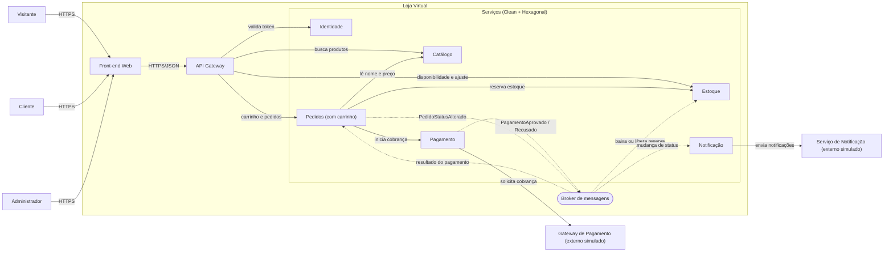

# C4 — Diagrama de Container (nível 2)

Abre a caixa "Loja Virtual" do [diagrama de Contexto](contexto.md): o front-end, o API Gateway, os seis serviços e o broker de mensagens, com as pessoas e os sistemas externos ao redor.

Base nas decisões:

- [ADR-0001](../adr/0001-estilo-arquitetural.md): SOA; cada serviço usa Clean + Hexagonal.
- [ADR-0002](../adr/0002-fronteiras-dos-servicos.md): Catálogo, Estoque, Pedidos (com carrinho), Pagamento, Notificação e Identidade.
- [ADR-0003](../adr/0003-comunicacao-entre-servicos.md): REST para comandos com resposta imediata, eventos para resultado do pagamento e notificações, API Gateway único.

## Versão C4 nativa do Mermaid

Usa a sintaxe `C4Container`, que o GitHub renderiza. O Mermaid to Excalidraw **não** converte esse tipo; para o Excalidraw use a versão em `flowchart` abaixo.

## Versão em flowchart (para o Excalidraw)

Mesmo conteúdo. Linha sólida é chamada REST e linha tracejada é evento via broker.

## Observações

- **Demonstração:** Pedidos, Estoque, Pagamento e Notificação são implementados. Catálogo é mínimo, com dados de exemplo, e Identidade fica só no diagrama (ADR-0002). Vale marcar isso na versão final do C4 para manter o código consistente com os diagramas (RNF05).
- **Dados:** cada serviço é dono dos seus dados (ADR-0002), mas o desenho físico (um banco por serviço ou compartilhado) ainda está em aberto e por isso não há bancos no diagrama.
- **Tecnologias:** front-end, gateway, serviços e broker estão como "A definir" até a escolha da stack.
- **Quem consome o resultado do pagamento:** o diagrama mostra Pedidos (atualiza o status) e Estoque (baixa ou libera a reserva) consumindo o evento. Isso depende da decisão de reserva de estoque e pode mudar.
- **Retorno do gateway externo:** a seta para o Gateway de Pagamento não mostra a volta da resposta, porque essa decisão ainda está em aberto.
