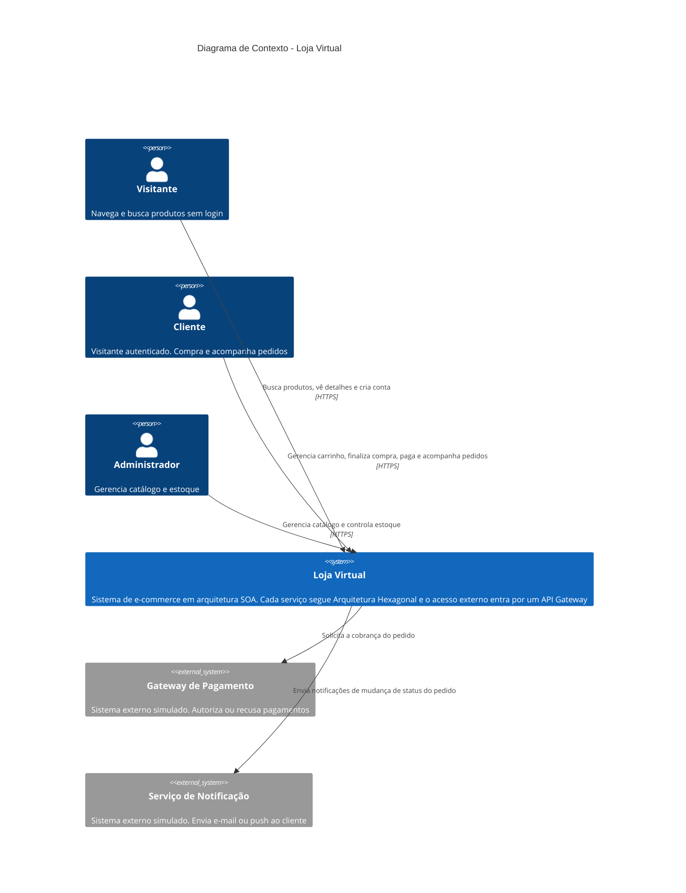
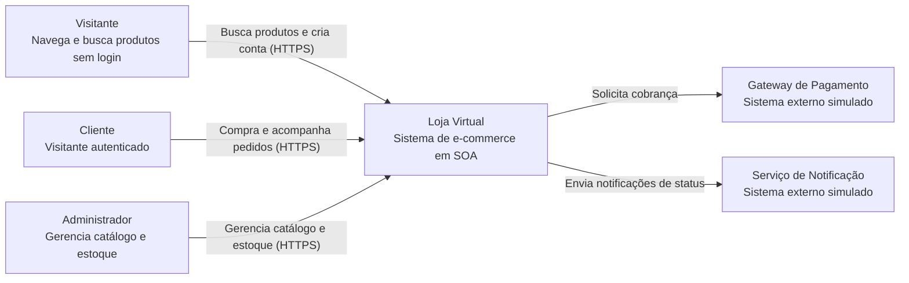

# C4 — Diagrama de Contexto (nível 1)

Visão geral da Loja Virtual: quem usa o sistema e com quais sistemas externos ele se integra. Neste nível o sistema aparece como **uma caixa só**; os serviços internos (Catálogo, Estoque, Pedidos, Pagamento, Notificação, Identidade) e o API Gateway só aparecem no diagrama de Container.

Como as decisões de arquitetura aparecem aqui:

| Decisão | Reflexo no Contexto |
|---|---|
| [ADR-0001](../adr/0001-estilo-arquitetural.md): SOA, com Hexagonal por serviço | Descrição do sistema; os externos entram por portas de saída e são simulados (RNF02) |
| [ADR-0002](../adr/0002-fronteiras-dos-servicos.md): seis serviços | Identidade é interna ao sistema, então não aparece como sistema externo |
| [ADR-0003](../adr/0003-comunicacao-entre-servicos.md): REST + eventos, API Gateway único | Todo acesso dos usuários entra pelo sistema por HTTPS (via API Gateway); detalhes ficam no Container |

## Versão C4 nativa do Mermaid

Usa a sintaxe `C4Context`, que o GitHub renderiza. O Mermaid to Excalidraw **não** converte esse tipo; para o Excalidraw use a versão em `flowchart` abaixo.

## Versão em flowchart (para o Excalidraw)

Mesmo conteúdo, em `flowchart`: pessoas e sistemas externos são retângulos, e o sistema em foco é destacado como uma caixa única.

## Observações

- **Retorno do pagamento:** decidido no [ADR-0005](../adr/0005-retorno-do-gateway.md) — o serviço de Pagamento recebe resposta síncrona do gateway externo **e** publica o resultado como evento (`pagamento.aprovado` / `pagamento.recusado`); o estado do pedido e do estoque muda só pelo evento. A seta do diagrama não detalha a volta porque aqui o sistema aparece como caixa única; o detalhe fica no Container.
- **Autenticação:** se ela for delegada a um provedor externo (OAuth), ele passa a aparecer aqui como sistema externo. Hoje Identidade é um serviço interno (ADR-0002).
