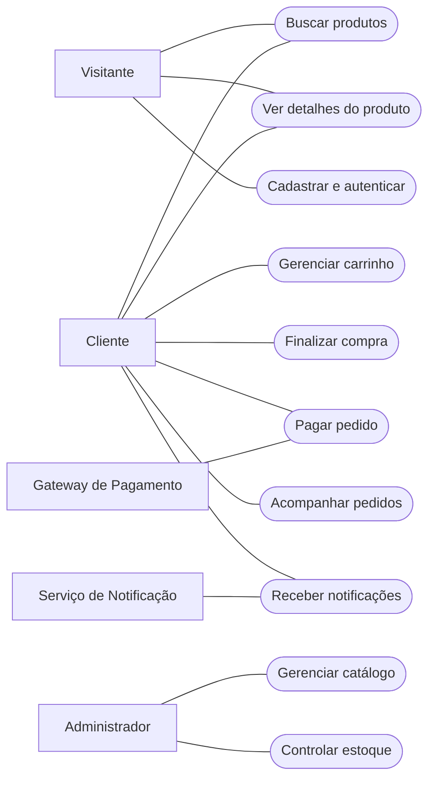

# Diagrama de casos de uso

Atores e funcionalidades da Loja Virtual (RF01 a RF10). O Mermaid não tem diagrama de casos de uso nativo, então foi escrito como `flowchart`: atores são retângulos e funcionalidades são elipses (formato estádio). Esse formato é aceito pelo Mermaid to Excalidraw.

## Correspondência com os requisitos

| Funcionalidade | Requisito |
|---|---|
| Buscar produtos | RF01 |
| Ver detalhes do produto | RF02 |
| Cadastrar e autenticar | RF03 |
| Gerenciar carrinho | RF04 |
| Finalizar compra | RF05 |
| Pagar pedido | RF06 |
| Acompanhar pedidos | RF07 |
| Receber notificações | RF08 |
| Gerenciar catálogo | RF09 |
| Controlar estoque | RF10 |
