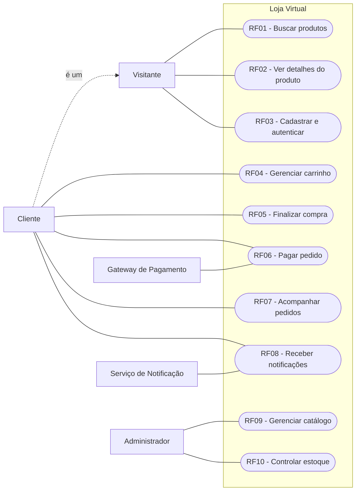

# Diagrama de casos de uso

Atores e casos de uso da Loja Virtual (RF01 a RF10). O Mermaid não tem diagrama de casos de uso nativo, então foi escrito como `flowchart`: atores são retângulos, casos de uso são elipses (formato estádio) e a fronteira do sistema é o `subgraph`. Esse formato é aceito pelo Mermaid to Excalidraw.

## Observações

- **Cliente herda de Visitante:** o Cliente é um Visitante autenticado, então também pode buscar produtos e ver detalhes (RF01, RF02). A herança evita repetir essas ligações.
- **Fluxo principal da demonstração:** RF04, RF05, RF06 e RF08, com RF10 de suporte.
- **Atores externos:** Gateway de Pagamento e Serviço de Notificação são simulados e ficam ligados apenas aos casos de uso em que participam (RF06 e RF08).
